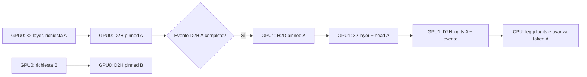

# HERMES-27: stream per richiesta e pipeline GPU0/GPU1

**Stato 2026-11-13:** analisi sorgenti + prototipo CUDA isolato. Test sintetico su due GPU **PASS** (4 richieste per 3 step); nessun benchmark del modello reale su questa pipeline. Il prototipo non e` collegato a `pp2::decode_step` e non dimostra miglioramenti reali di TPS.

## Evidenza del limite attuale

| Percorso | Evidenza nel sorgente | Conseguenza |
| --- | --- | --- |
| Batch parallelo | `pp2_batch.cu:81-103` avvia un host thread per richiesta, ciascuno chiama `pp2::decode_step`. | Più thread host non garantiscono stream GPU distinti. |
| GPU0/GPU1 decode | `pp2_fwd.cu:1214-1264` e le due routine `run_gdn_decode_layer`, `run_full_decode_layer`. | Ogni richiesta esegue GPU0 (32 layer), confine host, GPU1 (32 layer + head). |
| Stream implicito | kernel `<<<grid,block>>>`; `gemv_batch` chiama `nvfp4_gemv_cuda_variant` senza stream (`pp2_fwd.cu:265-275`); `gdn_step_cuda` lancia nello stream implicito (`kernels/src/gdn_step.cu:43-48`). | Con il default legacy, i comandi GPU di thread diversi condividono lo stesso stream per device: la pipeline intra-device tende a serializzarsi. L'attuale CMake non imposta `--default-stream per-thread`. |
| Device-wide sync | `pp2_fwd.cu:1222` dopo embedding, `:1260` dopo output head; `:1021,:1087` dopo ciascun layer salvo `HERMES_DECODE_SKIP_LAYER_SYNC=1`. | `cudaDeviceSynchronize()` aspetta anche lavoro degli altri stream sul device; lo skip di fine layer elimina solo **alcune** attese. |
| Pinned host condiviso | `pp2_fwd.cu:55-58` (`g_pinned`, `g_xfer_mu`); `:1232-1237` (`cudaMemcpy` GPU0 D2H e GPU1 H2D). | Mutex evita corruzione, ma serializza il trasferimento di tutte le richieste e blocca il thread durante la coppia di copie. |
| Stati ricorrenti | `DecodeState` possiede S, CS, Kc, Vc, workspace, logits per richiesta; `pp2_fwd.cu:1036-1039,1088` valida e incrementa `klen` host. | Gli stati sono separati; occorre impedire due token contemporaneamente sulla **stessa richiesta**. |

**Avvertenza su default stream:** NVIDIA distingue default stream **legacy** (un solo stream per dispositivo, condiviso tra host thread) e `--default-stream per-thread`. Lo stato della compilazione va verificato sul *binario* prima delle misure. Non assumere che un mutex elimini implicitamente tutte le dipendenze tra stream non bloccanti. Riferimento: [CUDA Asynchronous Execution, default/legacy/per-thread streams](https://docs.nvidia.com/cuda/cuda-programming-guide/02-basics/asynchronous-execution.html).

## Pipeline proposta

Creare per ogni richiesta ammessa **due** `cudaStreamNonBlocking` (uno su ciascuna GPU), **due** eventi con timing disabilitato e **due** buffer pinned (`hidden` + `logits`). I pesi rimangono residenti e condivisi, ma cache GDN, convoluzione, KV, workspace e logits restano proprietà della richiesta. Non c'e` un singolo stream globalmente condiviso per il lavoro concorrente. Il prototipo protegge le transizioni di stato host con un mutex: più caller possono accedere all'API senza data race sugli slot, mentre il lavoro CUDA rimane asincrono e non viene serializzato dal mutex dopo l'enqueue. I puntatori device devono essere distinti fra richieste e le callback non devono scrivere su memoria di altre richieste.



Il worker CPU può accodare GPU0/B mentre attende GPU1/A. Una singola richiesta passa attraverso gli stati `Idle → Stage0 → Stage1 → Idle`; un errore la mette in `Fault`, senza riuso. Per ogni token:

1. Accodare embedding e layer 0-31 nello stream GPU0 della richiesta. Accodare `cudaMemcpyAsync` GPU0→buffer pinned **dopo** il layer 31. Registrare `stage0_copied` nello stesso stream.
2. Con `cudaEventQuery(stage0_copied)` attendere la disponibilità del buffer pinned **prima** di avviare GPU1. Una query non pronta è un normale stato, non un errore. Non occorre `cudaDeviceSynchronize` né sincronizzazione globale. Eventi locali a GPU0 sono consultati dal thread host; il prototipo non fa affidamento su eventi tra device.
3. Accodare `cudaMemcpyAsync` pinned→GPU1 nello stream GPU1 della richiesta, quindi layer 32-63, head, copia D2H dei logits e `stage1_copied` **in quello stesso stream**. Non riutilizzare o scrivere i buffer pinned finché l'evento non è pronto.
4. Dopo evento GPU1 completo, copiare i logits dal buffer pinned e solo allora permettere il token successivo (o release dello stato). Questo ordine preserva anche KV/GDN e `klen`: nessun passo puo` sovrapporsi al precedente sulla stessa richiesta.

La copia D2H GPU0 trasferisce **20.480 byte/token** (hidden FP32 da 5.120). I logits FP32 su GPU1 sono **993.280 byte/token** (vocab da 248.320). Il prototipo alloca pinned per richiesta pari alla loro somma (1.013.760 byte/richiesta), ossia circa **15,47 MiB a N=16**, più oggetti stream/eventi. Le allocazioni GPU *già esistenti* di `DecodeState` possono essere riutilizzate in futuro: il prototipo non alloca device memory e accetta puntatori posseduti dal chiamante. I buffer pinned sono separati, per cui non serve mutex globale sul confine.

## Prototipo compilabile, ma non integrato nel runtime

- `distributed/pp2_batch_streams_prototype.hpp/.cu`: API indipendente `TwoStagePipeline`, state machine per richiesta, stream/eventi per device, doppio staging asincrono e gestione fallimenti. Le callback `Stage0Enqueue` / `Stage1Enqueue` ricevono sempre uno stream esplicito. Non tocca la produzione né lancia kernel del modello.
- `distributed/test_batch_streams_synthetic.cu`: quattro richieste, tre turni, input distinti, kernel sintetici di GPU0/GPU1 che producono valori esattamente prevedibili. Controlla tutti gli output, lifecycle e barriera eventi; richiede **due GPU esclusive** e ha restituito **PASS** sul server Hermes il 13/11/2026.
- Test/compile isolato, senza modifiche a CMake, eseguibile via comandi manuali, vedi sotto.

### Comandi di compilazione isolata (senza GPU)

```bash
nvcc -std=c++20 -arch=sm_120a --expt-relaxed-constexpr -c \
  distributed/pp2_batch_streams_prototype.cu -o /tmp/pp2_batch_streams_prototype.o
nvcc -std=c++20 -arch=sm_120a --expt-relaxed-constexpr \
  distributed/pp2_batch_streams_prototype.cu \
  distributed/test_batch_streams_synthetic.cu \
  -o /tmp/test_batch_streams_synthetic
```

La compilazione non richiede modello o GPU libera. Il binario sintetico e` stato ricompilato in scratch e ha superato `timeout 30 /tmp/h27_streams_syn_verified` con entrambe le RTX 5060 Ti libere; il lavoro ha lasciato intatti i servizi di produzione. L'esecuzione di benchmark reali del modello resta subordinata a una nuova integrazione nel runtime e a una finestra GPU esclusiva.

**Verifiche effettivamente eseguite (2026-11-13):** compilazione oggetto e link del test sintetico con `nvcc` CUDA 12.8, C++20, `sm_120a`, exit **0**; compilazione ed esecuzione di un controllo C++ host-only (`g++`, `static_assert` sulle callback e ownership non copiabile), exit **0**. Binari nel solo scratch `/tmp/hermes-worker4-streams-20261113/`. Nessuna chiamata al runtime CUDA o workload GPU avviati dai test: l'eseguibile sintetico e` stato **compilato ma non lanciato**. La correttezza GPU e l'overlap effettivo restano **NON VERIFICATI**.

## Passi di integrazione successivi (richiedono ownership separata)

1. Esporre da `pp2_fwd.cu` un decode a **due stage espliciti**, senza modificare inizialmente il decode sincrono. Entrambi ricevono `cudaStream_t` e il `DecodeState` della richiesta. Non reimplementare GDN/KV nel scheduler.
2. Propagare il parametro `stream` attraverso **tutti** i kernel del layer, `gemv_batch`, `nvfp4_gemv_cuda_variant`, `gdn_step_cuda` e head BF16, includendo branch Warp4. I kernel `<<<...>>>` devono diventare `<<<...,0,stream>>>`; la copia D2D per il KV full-attention va accodata con `cudaMemcpyAsync(...,cudaMemcpyDeviceToDevice,stream)` prima della SDPA. Nessun lancio correlato deve cadere sullo stream 0 per errore.
3. Sostituire le sincronizzazioni `cudaDeviceSynchronize` del decode con eventi/sync **per richiesta**. Anche embedding e head hanno ancora sync globale; non si ottiene indipendenza fra stream se restano nel nuovo percorso. Lasciare la vecchia API e il percorso di debug per rollback.
4. Validare `klen` e capacità prima di enqueue; aggiornare il contatore host in modo atomico rispetto all'ammissione dello step, o dopo il completion event, evitando doppio submit. Escludere stati in `Fault` dal nuovo lavoro e drenare stream prima di liberarli. Verificare che nessuna allocazione/free CUDA avvenga nella fase calda.
5. Integrare con scheduler bounded già esistente: ogni richiesta ha un solo token in flight; `cudaEventQuery` fa avanzare richieste pronte, con fair queue/backpressure. Non mescolare vecchio decode legacy e nuovo decode-streams sul medesimo stato senza eventi espliciti.
6. Solo dopo confronto logits/token per ogni step, misurare latenza per stage, TTFT, TPS aggregati e GPU utilization a N=1/2/4/8. Verificare VRAM, fine stream, cancellazioni, errori GPU, rollback e assenza di cross-request corruption.

## Potenziale teorico (ipotesi, non benchmark)

Siano `t0` il tempo GPU0 per token, `t1` quello GPU1 e `h` il costo effettivo del trasferimento/dispatcher. Una richiesta isolata percorre approssimativamente `t0 + h + t1`. Con richieste indipendenti già pronte, la produttività di una pipeline ideale a due stage è limitata dal più lento fra i due: **intervallo per token aggregato ≥ max(t0, t1)**, a cui aggiungere qualsiasi collo di bottiglia di trasferimento, CPU, copy engine, head o memoria. Nel modello semplificato privo di overhead, lo speedup rispetto all'esecuzione strettamente sequenziale ha limite teorico `(t0+t1)/max(t0,t1) ≤ 2`; non è una previsione sull'hardware reale, e il batch threaded precedente potrebbe già sovrapporre parte del lavoro fra le GPU.

Gli stream indipendenti **non** riducono i byte dei pesi letti da ogni decode e non moltiplicano la banda di memoria. Se GPU0 o GPU1 è già saturata dal singolo GEMV, aggiungere richieste può aumentare latenza e non il throughput; MTP, prefill e head hanno ulteriori vincoli. Nessun valore di TPS o fattore di accelerazione viene attribuito al prototipo senza misurazioni.

## Criteri fail-closed

- Prima: build sullo stesso commit/config, confronto decoder originale vs stream per logits FP32 (`max_abs ≤ 1e-4` + argmax identico), token generati, EOS e contesti 128/129/1024/8192. Ripetere con scalar/Warp4 e head originale/ottimizzato separatamente.
- Poi: test sintetico, due richieste con posizioni diverse, interleave con 4 richieste, cancellazione in ogni stage, disponibilità GPU ridotta, mancato record/evento, buffer riutilizzato prematuramente, timeout e leak.
- Infine: throughput A/B N=1/2/4/8, almeno tre misure comparabili, timestamp CUDA events per stage e contatori GPU per stabilire se l'overlap esiste davvero. Su errore, mantenere API sincrona e flag di opt-in OFF.

**Blocchi attuali:** funzioni del decode reale sono `static` e non accettano stream; `gdn_step_cuda` non accetta stream; altre librerie potrebbero imporre implicitamente stream default. Il test GPU sintetico e` PASS, ma il prototipo è una dimostrazione architetturale ispezionabile, non una sostituzione eseguibile del motore HERMES-27.
